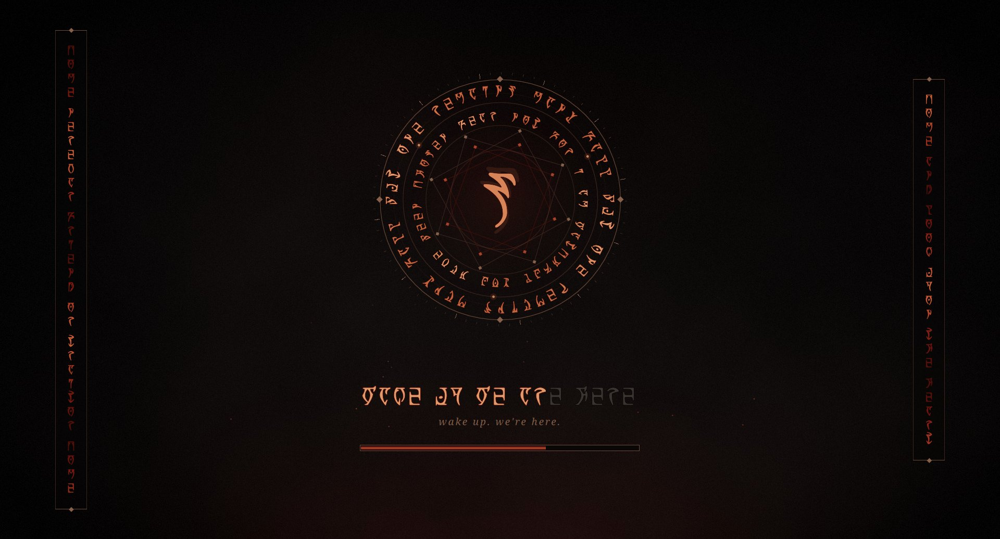

# Daedric Morrowind — Plasma Splash Screen

The splash shown while Plasma starts. The Daedric script is real: it is set in **OMW Ayembedt** by Georg Duffner
(SIL Open Font License 1.1), which maps the Latin letters A–Z onto the Daedric
alphabet, so every inscription is a readable phrase.

## What is on screen

- **The sigil:** a tick ring, two counter-rotating rings of Daedric script with heat
  travelling around them, orbiting embers, two eight-point stars turning against
  each other, ripples, and a breathing rune.
- **Progress:** the inscription ignites rune by rune over Plasma's startup stages,
  with a thin bar beneath it.
- **Banners:** a shimmering column of Daedric down each side, with ash and embers
  drifting across.

## What the runes say

| where | inscription |
|---|---|
| outer ring | MANY FALL BUT ONE REMAINS |
| inner ring | FEAR NOT FOR I AM WATCHFUL YOU HAVE BEEN CHOSEN |
| left banner | COME NEREVAR FRIEND OR TRAITOR COME |
| right banner | COME AND LOOK UPON THE HEART |
| progress line | WAKE UP WE ARE HERE |

The inscriptions are properties at the top of `contents/splash/DaedricScene.qml`
and `Splash.qml` (letters A–Z and spaces only).

## Requirements

Plasma 6. Noto Serif for the one Latin caption (any serif works). The Daedric font is bundled.

## Install

    git clone https://github.com/numbpill3d/daedric-morrowind-splash
    cd daedric-morrowind-splash
    ./install.sh

Then choose **Daedric Morrowind** in System Settings › Colors & Themes › Splash Screen.

## Preview

    ksplashqml --test --window ~/.local/share/plasma/look-and-feel/scorn.daedricmorrowind

## The rest of the suite

| piece | repo |
|---|---|
| SDDM login | [daedric-morrowind-sddm](https://github.com/numbpill3d/daedric-morrowind-sddm) |
| Plymouth boot splash | [daedric-morrowind-plymouth](https://github.com/numbpill3d/daedric-morrowind-plymouth) |
| Plasma splash screen | [daedric-morrowind-splash](https://github.com/numbpill3d/daedric-morrowind-splash) |
| Lock screen wallpaper | [daedric-morrowind-lockscreen](https://github.com/numbpill3d/daedric-morrowind-lockscreen) |
| Window decoration | [daedric-morrowind-aurorae](https://github.com/numbpill3d/daedric-morrowind-aurorae) |
| Konsole + kitty colours | [daedric-morrowind-konsole](https://github.com/numbpill3d/daedric-morrowind-konsole) |

## Credits and licence

By splicer scorn (voidrane). GPL-3.0-or-later.
Daedric font: OMW Ayembedt © 2013 Georg A. Duffner, SIL OFL 1.1 (licence text included next to the font).

Unofficial fan work. The Elder Scrolls and Morrowind are trademarks of their
owner; a few short in-world phrases are quoted as inscriptions.
